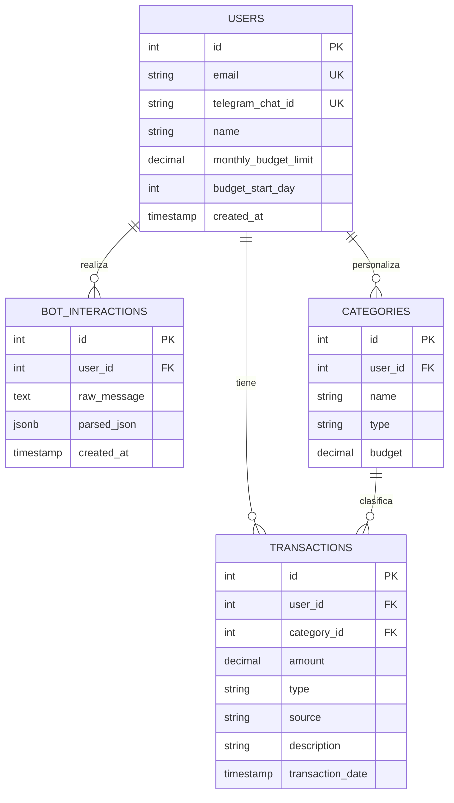

<!--
Sync Impact Report:
- Version change: 1.2.0 -> 1.3.0
- Modified principles: None
- Added sections: Deployment Environments (`dev` deployed automatically from `develop` after the
  DevSecOps pipeline completes in report-only mode under EX-001; `prod` deployed only from `main`
  after every security gate passes)
- Modified sections: Additional Constraints (deployment clause now distinguishes `prod` from `dev`);
  Temporary Exemptions / EX-001 (deployment sentence now points to Deployment Environments)
- Removed sections: None
- Follow-up TODOs: Review EX-001 on or before its expiry date; when it expires, `dev` deployments
  MUST again require passing security gates (see Deployment Environments)
-->

# MisiOps Constitution

## Core Principles

### I. Code Quality

All code MUST be clear, maintainable, and adhere to established style guidelines. Complexity MUST be justified. Refactoring is expected as part of the normal development lifecycle to prevent technical debt accumulation. This ensures that the codebase remains accessible and modifiable by all team members over time.

### II. Testing Standards (NON-NEGOTIABLE)

All new features and bug fixes MUST be accompanied by appropriate automated tests (unit, integration, or end-to-end). A Test-Driven Development (TDD) approach SHOULD be utilized where feasible. Changes MUST NOT be merged if they decrease overall test coverage or if any tests fail. Robust testing is critical for preventing regressions and maintaining high confidence in releases.

### III. User Experience Consistency

The application MUST provide a cohesive and predictable user experience. UI components, terminology, and interaction patterns MUST remain consistent across all screens and flows. Any deviation from established patterns MUST be explicitly justified and approved. This minimizes cognitive load on users and establishes brand trust.

### IV. Performance Requirements

Features MUST be designed and implemented with performance in mind. Latency MUST be minimized, and resource usage MUST be optimized. Any new functionality that degrades performance benchmarks MUST be rejected or immediately remediated. Fast and responsive applications are essential for user satisfaction and operational efficiency.

## Product Context

### Problem Statement

People often fail to track their personal finances, leading them into debt or leaving them with little to no money by the end of the month, because they lack traceability of where their money actually goes.

### Objectives

Deliver MisiOps: an end-to-end platform (frontend, backend, and a simple database) that helps people register their incomes and expenses via a natural-language-processing chatbot, and track their money throughout the month via a dashboard.

Roadmap (not yet in scope for the current build, documented here for architectural awareness):

- Scrape the user's personal Gmail inbox to detect bank/digital-wallet transaction notifications (e.g., Peru's Yape and Plin) and register them automatically.
- Train MLOps models on user transaction history to predict end-of-month savings.

### User Personas

**Iare** — a young man with a full-time job and medium earnings, but heavy debt obligations and consumerist habits, leaving him with close to zero savings most months. He wants a way to track his expenses but doesn't have time to log them at the end of each day — he needs low-friction, fast logging (hence the NLP chatbot interface over manual data entry forms).

## Technology Stack

### Stack

- **Frontend**: Next.js, TypeScript, Tailwind CSS, package manager: npm
- **Backend**: Python, FastAPI, package manager: uv
- **Database**: PostgreSQL

### Repository Structure

Monorepo layout (see `AGENTS.md` for the authoritative version):

```text
MisiOps/
├── .agents/          # AI agent configuration and skills
├── .specify/         # SDD lifecycle artifacts (constitution, templates, scripts)
├── backend/          # FastAPI application
│   ├── core/         # Global config, env vars, DB setup
│   ├── models/       # SQLAlchemy models
│   ├── main.py       # FastAPI entrypoint
│   └── pyproject.toml # Backend dependencies (managed with uv)
├── diagrams/          # Architecture diagrams (e.g. Excalidraw, ERDs)
├── frontend/          # Next.js client application
├── infra/             # AWS CDK infrastructure (TypeScript)
├── specs/             # Feature specifications (spec-kit output)
├── AGENTS.md          # Agent rules and guidelines
└── mcp-config.json    # MCP server configuration
```

### Data Base Schema

Source: `diagrams/database-schema.png`.



## Additional Constraints

Technology stack choices and architectural decisions MUST prioritize security and maintainability. Third-party dependencies MUST be kept up-to-date and audited regularly for known vulnerabilities. Production deployments MUST NOT occur without passing automated security scans; non-production deployments follow the Deployment Environments section.

## Development Workflow

Development MUST occur on feature branches and be integrated via Pull Requests (PRs). Every PR MUST receive at least one peer review that specifically checks for adherence to these constitutional principles. Code MUST NOT be merged until all automated Continuous Integration (CI) quality gates (tests, linting, security scans) have passed successfully.

## Deployment Environments

MisiOps has exactly two deployment environments, both provisioned from the same infrastructure-as-code definition stored in this repository:

- **`dev` (non-production)**: Deployed automatically on every push to `develop`, triggered when the DevSecOps pipeline for that push completes. While EX-001 is in force, the pipeline runs in report-only mode on `develop`, so `dev` MAY receive code with open security findings; it MUST NOT hold real user data and MUST NOT be exposed as a production service. Tests and linting still gate every pull request into `develop`, so nothing reaches `dev` without passing them.
- **`prod` (production)**: Deployed only from `main`, and only after every security gate of the DevSecOps pipeline has passed in blocking mode. Production deployments MUST require an explicit approval by a reviewer before the deployment job runs.

Both environments MUST deploy the exact container images that the DevSecOps pipeline built and scanned for that commit; rebuilding images in the deployment step is forbidden. Deployment credentials MUST be short-lived (OIDC federation); long-lived cloud access keys MUST NOT be stored in the repository or in CI secrets. A failed deployment MUST roll back automatically to the previous healthy version.

When EX-001 expires without renewal, `dev` deployments MUST also require passing security gates.

## Temporary Exemptions

### EX-001 — Security-scan gate moves from `develop` to `main`

- **Scope**: The Development Workflow clause "Code MUST NOT be merged until all automated CI quality gates (… security scans) have passed", **only for security scans and only for merges into `develop`**. Tests and linting still gate every merge.
- **Rule while in force**: Security scans run and report on every pull request into `develop`. Every merge into `main` MUST pass every security scan (CRITICAL/HIGH findings and detected secrets block it), enforced by required status checks on `main`. Production deployments still happen only from `main` after passing scans; the non-production `dev` environment is deployed from `develop` as described in Deployment Environments.
- **Justification**: Requested by the team lead (2026-11-05) so that `develop` can integrate work while findings are triaged, while nothing with an open security alert reaches `main`.
- **Approval**: Technical leadership review on the pull request that introduces it (feature `011-devsecops`).
- **Expiry**: 2026-12-31. On expiry, either renew it with a new review or make the security checks required on `develop` as well (steps in `docs/devsecops/EVIDENCIAS.md`).

## Governance

This Constitution supersedes all other engineering practices and guidelines.
Amendments to this document require a formal proposal, review by technical leadership, and an explicit transition plan for any breaking changes to workflow or standards.
Versioning of this constitution follows Semantic Versioning (MAJOR for significant shifts or rule removals, MINOR for additions, PATCH for clarifications).
All PRs and code reviews MUST actively verify compliance with these rules.

**Version**: 1.3.0 | **Ratified**: 2026-09-09 | **Last Amended**: 2026-11-07
