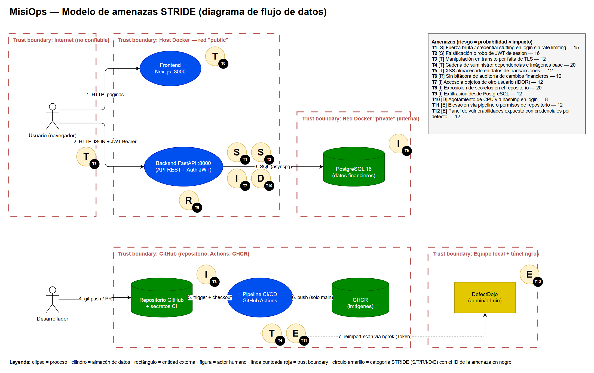
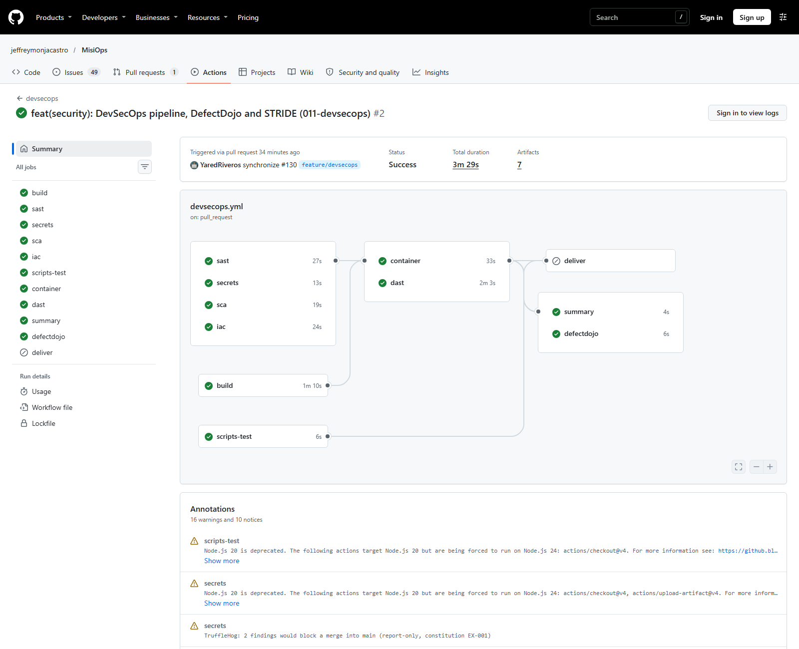
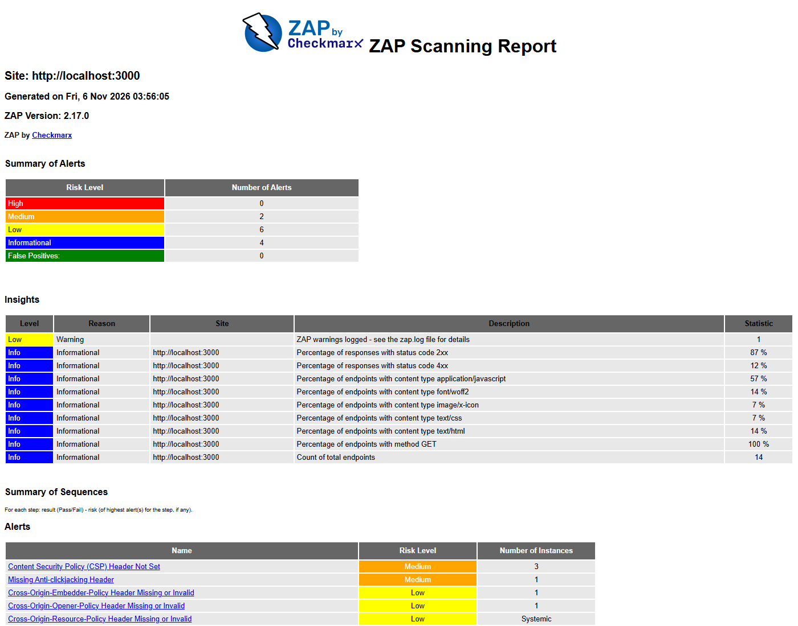
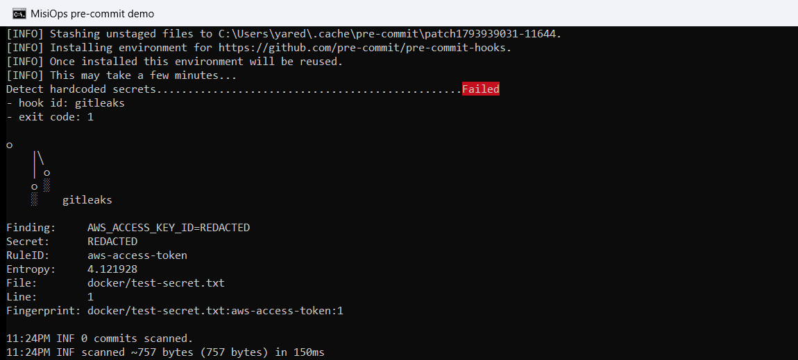
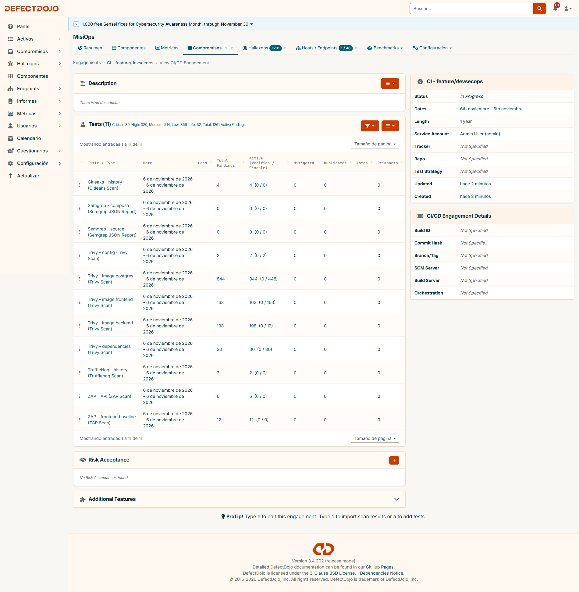
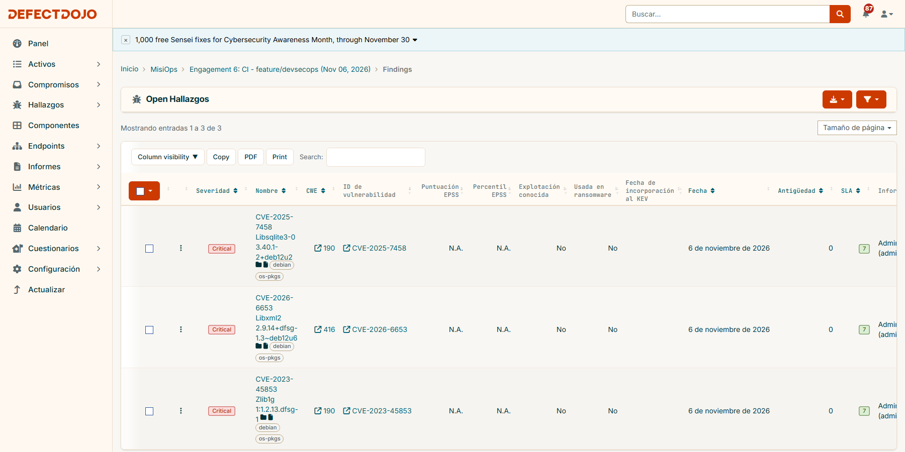
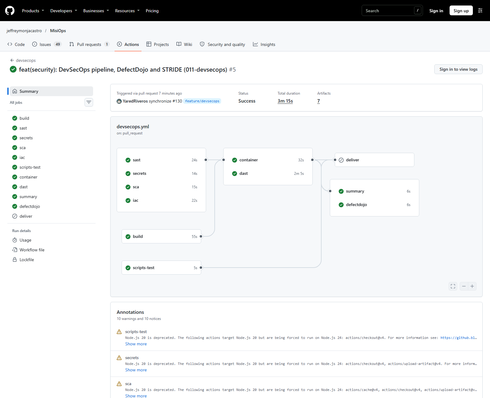
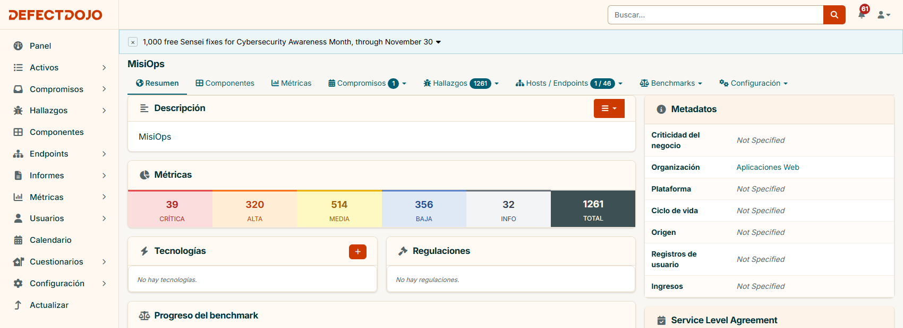
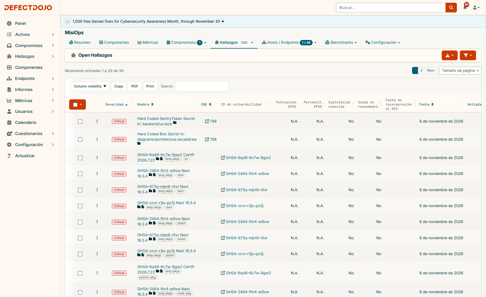
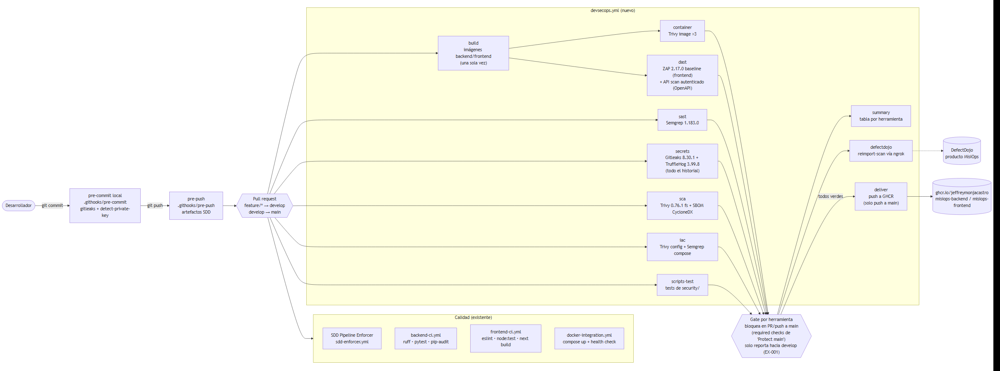

# MisiOps — Evidencias DevSecOps (Informe final, ítem 2)

Documento de evidencias de la parte DevSecOps del proyecto (curso DevOps IS4024, UTEC). Cada pregunta del ítem 2 del enunciado tiene su respuesta, su evidencia (captura o, solo cuando no se puede, log) y la **ubicación en el repositorio** del artefacto.

- Repositorio: https://github.com/jeffreymonjacastro/MisiOps (rama `feature/devsecops`, PR [#130](https://github.com/jeffreymonjacastro/MisiOps/pull/130))
- Especificación SDD de esta parte: [`specs/011-devsecops/`](../../specs/011-devsecops/)

## Índice

| Ítem | Pregunta | Sección |
| --- | --- | --- |
| 2a | Título y descripción | [2a](#2a-título-y-descripción) |
| 2b | Diagrama STRIDE | [2b](#2b-diagrama-de-modelado-de-amenazas-stride) |
| 2c | Cinco vulnerabilidades principales | [2c](#2c-cinco-principales-vulnerabilidades-stride) |
| 2d | SAST y DAST | [2d](#2d-sast-y-dast) |
| 2e | Secret scanning y SCA | [2e](#2e-secret-scanning-y-sca) |
| 2f | Centralización en DefectDojo | [2f](#2f-centralización-en-defectdojo) |
| 2g | Tabla de mitigación | [2g](#2g-tabla-de-mitigación) |
| 2h | Situación inicial vs. resultados | [2h](#2h-situación-inicial-vs-resultados) |
| 2i | Pipeline completo | [2i](#2i-pipeline-completo) |
| 2j | Lecciones aprendidas | [2j](#2j-lecciones-aprendidas) |
| 2k | Recomendaciones | [2k](#2k-recomendaciones) |
| — | Política de gates y riesgos aceptados | [Política](#política-de-gates-y-riesgos-aceptados) |

---

## 2a. Título y descripción

**¿Cuál es el título y de qué trata esta parte del proyecto?**

**MisiOps DevSecOps: seguridad integrada en el pipeline de una app de finanzas personales.**

MisiOps es una aplicación web (Next.js + FastAPI + PostgreSQL) donde cada usuario registra ingresos, gastos y presupuestos por categoría. Como maneja credenciales y datos financieros, en esta parte modelamos sus amenazas con STRIDE y metimos la seguridad dentro del pipeline:

- Cada cambio pasa por SAST, DAST, escaneo de secretos, SCA con SBOM, escaneo de imágenes y de configuración.
- Todos los hallazgos se centralizan en DefectDojo.
- Ningún cambio con una alerta abierta llega a `main`.

Medimos una línea base, remediamos lo prioritario y re-escaneamos.

---

## 2b. Diagrama de modelado de amenazas STRIDE

**¿Cómo se ve el modelo de amenazas del sistema?**

Diagrama de flujo de datos con los límites de confianza (Internet, red Docker `public`, red Docker `private`, GitHub y el equipo local con el túnel). Cada amenaza está marcada con su letra STRIDE y su ID.

La plantilla STRIDE del curso quedó llena con 12 amenazas, que cubren las 6 categorías. Incluye probabilidad e impacto según OWASP Risk Rating, riesgo inherente, controles actuales, efectividad y riesgo residual.

- Ubicación en el repo: [`docs/devsecops/stride/misiops-stride.drawio`](stride/misiops-stride.drawio) (editable en draw.io), [`misiops-stride.png`](stride/misiops-stride.png), [`plantilla-stride-misiops.xlsx`](stride/plantilla-stride-misiops.xlsx), [`amenazas.json`](stride/amenazas.json) (mismos datos en texto)
- Link compartible del diagrama: _pendiente: se agrega tras subir el `.drawio` al drive del equipo (paso manual M4)_
- Link compartible de la plantilla: _pendiente: se agrega tras subir el `.xlsx` al drive del equipo (paso manual M4)_

---

## 2c. Cinco principales vulnerabilidades STRIDE

**¿Cuáles son las cinco amenazas más importantes y por qué?**

Las ordenamos por **riesgo = probabilidad × impacto**, ambos en escala 1-5 según la plantilla. Si hay empate, primero va la que afecta credenciales o datos financieros.

| # | ID | STRIDE | Amenaza | Componente | P × I | Mitigación aplicada / propuesta |
| --- | --- | --- | --- | --- | --- | --- |
| 1 | T8 | Information Disclosure | Un secreto (SECRET_KEY, contraseña de BD, token de DefectDojo) se sube al repo público o queda en el historial | Repositorio GitHub + secretos CI | 5 × 4 = **20** | Gitleaks + TruffleHog sobre todo el historial en CI, hook pre-commit, secretos solo en GitHub Secrets |
| 2 | T4 | Tampering | Una dependencia vulnerable o comprometida, o una imagen base sin versión fija (`uv:latest`), entra a la imagen que se publica | Pipeline CI/CD | 5 × 4 = **20** | SCA + SBOM y escaneo de imágenes con Trivy, `uv` fijado por digest, entrega solo si todo pasa |
| 3 | T2 | Spoofing | Falsificar o reutilizar un JWT si la SECRET_KEY es débil o se filtra | Autenticación JWT | 4 × 4 = **16** | Clave de ≥32 bytes desde secretos; propuesto: rotación y revocación |
| 4 | T1 | Spoofing | Fuerza bruta o credential stuffing en `/auth/login`, que no tiene límite de intentos | Autenticación JWT | 5 × 3 = **15** | argon2 + respuesta uniforme; propuesto: rate limiting y bloqueo temporal |
| 5 | T7 | Information Disclosure | IDOR: cambiar el ID en `/transactions/{id}` para ver datos de otro usuario | Backend FastAPI | 4 × 3 = **12** | Cada consulta filtra por `user_id` del token, con tests de 404 para recursos ajenos |

T8 y T4 fueron las que más guiaron el pipeline: los escáneres de secretos y de dependencias/imágenes existen justamente para cerrarlas. La ficha completa de cada amenaza está en la hoja `1) Amenazas` de la plantilla.

---

## 2d. SAST y DAST

**¿Qué herramientas de SAST y DAST se eligieron y por qué?**

| Tipo | Herramienta (versión fijada) | Por qué |
| --- | --- | --- |
| SAST | **Semgrep 1.183.0** (`p/default`, `p/python`, `p/typescript`) | Cubre Python y TypeScript con una sola herramienta, es rápido (<30 s) y es la del laboratorio del curso |
| DAST | **OWASP ZAP 2.17.0**: *baseline* sobre el frontend y *API scan* autenticado con el OpenAPI de FastAPI | El API scan importa todos los endpoints desde `/openapi.json` y entra con un JWT real, así que prueba también las rutas protegidas |

**¿Cómo se integraron al pipeline?**

- Job `sast` en [`.github/workflows/devsecops.yml`](../../.github/workflows/devsecops.yml): Semgrep corre desde su imagen fijada y genera JSON y texto.
- Job `dast`: levanta el `docker compose` del proyecto **con las mismas imágenes que se escanean y se publican**. Las credenciales de BD y la SECRET_KEY se generan al vuelo y nunca se versionan. Después registra un usuario temporal, obtiene su token (enmascarado en el log) y corre los dos escaneos ZAP.
- Si ZAP no logra alcanzar la app, el job falla en lugar de reportar "sin hallazgos".

**¿Qué reportes se obtuvieron?**

- Línea base: Semgrep con 0 hallazgos en 76 archivos. ZAP con 12 alertas en el frontend (CSP ausente, anti-clickjacking, `X-Content-Type-Options`, `X-Powered-By`, `Permissions-Policy`, COOP/CORP) y 6 en la API.
- Los reportes se descargan como artefactos de cada corrida (7 días) y quedaron archivados en el repo.

- Ubicación en el repo: [`docs/devsecops/reports/baseline/semgrep.json`](reports/baseline/semgrep.json), [`zap-frontend.html`](reports/baseline/zap-frontend.html), [`zap-api.html`](reports/baseline/zap-api.html), [`security/zap/rules.conf`](../../security/zap/rules.conf), [`.semgrepignore`](../../.semgrepignore)

---

## 2e. Secret scanning y SCA

**¿Qué herramientas se usaron para secretos y dependencias?**

| Tipo | Herramienta | Alcance |
| --- | --- | --- |
| Secretos (CI) | **Gitleaks 8.30.1** | Patrones y entropía sobre **todo el historial** (`fetch-depth: 0`) |
| Secretos (CI) | **TruffleHog 3.99.8** | Segundo detector independiente, también sobre el historial, con verificación de credenciales vivas |
| Secretos (local) | **pre-commit** con el hook de Gitleaks y `detect-private-key` | Bloquea el commit antes de que llegue al repo |
| SCA + SBOM | **Trivy 0.76.1** `fs` | `backend/uv.lock` y `frontend/pnpm-lock.yaml`, más un SBOM CycloneDX |
| Imágenes | **Trivy** `image` | Imágenes backend y frontend construidas en el job, más `postgres` |
| IaC / configuración | **Trivy** `config` + **Semgrep** `p/docker-compose` | Dockerfiles y `docker-compose.yaml` (Trivy no analiza Compose) |

**¿Cómo se integraron y qué encontraron?**

- Jobs `secrets`, `sca`, `container` e `iac` del mismo workflow.
- En la línea base, Gitleaks reportó 4 hallazgos y TruffleHog 2. Al revisarlos todos resultaron falsos positivos: nombres de claves de `localStorage`, la clave AWS de ejemplo del quickstart, un hash de `uv.lock` y datos de imagen de un diagrama. Quedaron en las listas de excepciones con justificación y fecha de revisión.
- SCA encontró **7 CRITICAL y 9 HIGH**: Next.js 16.3.4, certifi, dnspython, sharp, source-map-js y un `package-lock.json` npm obsoleto que duplicaba hallazgos.

El hook local bloqueando un commit con una clave AWS de prueba:

- Ubicación en el repo: [`.gitleaks.toml`](../../.gitleaks.toml), [`security/trufflehog-exclude.txt`](../../security/trufflehog-exclude.txt), [`.pre-commit-config.yaml`](../../.pre-commit-config.yaml), [`.githooks/pre-commit`](../../.githooks/pre-commit), [`.trivyignore.yaml`](../../.trivyignore.yaml), [`reports/baseline/trivy-deps.txt`](reports/baseline/trivy-deps.txt), [`reports/baseline/sbom.cdx.json`](reports/baseline/sbom.cdx.json)

---

## 2f. Centralización en DefectDojo

**¿Cómo se centralizan las vulnerabilidades?**

DefectDojo 3.4.202 corre en local con Docker Compose y se expone a GitHub Actions mediante un túnel ngrok. Desde ahí:

- El job `defectdojo` sube cada reporte con `POST /api/v2/reimport-scan/`.
- Todo queda bajo *Product Type* "Aplicaciones Web" → *Product* "MisiOps" → *Engagement* "CI - \<rama\>".
- Cada reporte tiene un *Test* con título propio (por ejemplo "Trivy - image backend").

La reimportación con `close_old_findings` no duplica hallazgos y cierra los que ya no aparecen. Usamos un título distinto por reporte porque con un título compartido, como en el script del laboratorio, la importación de un reporte cerraba los hallazgos de otro.

Si el túnel no está activo, la subida se omite sin romper los escaneos, y `security/scripts/import_run.sh <run-id>` descarga los artefactos de esa corrida y los importa desde la máquina local.

- Ubicación en el repo: [`security/scripts/upload_to_defectdojo.sh`](../../security/scripts/upload_to_defectdojo.sh), [`security/scripts/import_run.sh`](../../security/scripts/import_run.sh), [`security/scripts/reports.tsv`](../../security/scripts/reports.tsv), [`security/tests/test_upload_to_defectdojo.sh`](../../security/tests/test_upload_to_defectdojo.sh) (36 casos, se ejecutan en CI en el job `scripts-test`)

---

## 2g. Tabla de mitigación

**¿Qué hallazgos se priorizaron y cómo se mitigaron?**

El orden es por severidad. Dentro de una misma severidad, primero lo que afecta credenciales o datos financieros (amenazas T1, T2, T7, T8, T9).

| ID | Descripción | Severidad | Herramienta | Recomendación de mitigación (aplicada) | Estado |
| --- | --- | --- | --- | --- | --- |
| CRIT-001 | Next.js 16.3.4 con GHSA-vcvr-r3jv-pc5j, GHSA-673q-mjm6-r5xr y GHSA-2464-fhr4-w9xw (+2 HIGH), en el lockfile y en la imagen del frontend | Critical | Trivy SCA + Trivy image | Subir a `next` 16.4.5 y eliminar el `package-lock.json` npm obsoleto (commit `5883661`) | Mitigado |
| CRIT-002 | certifi 2026.7.22 (GHSA-6q48-6c7w-9gw2): almacén de CA usado por las conexiones TLS del backend | Critical | Trivy SCA + Trivy image | Subir a certifi 2026.10.23 (commit `5883661`) | Mitigado |
| CRIT-003 | `postgres:16.3` con 24 CRITICAL del SO (p. ej. libgnutls30 CVE-2026-33845) y 170 hallazgos corregibles en total | Critical | Trivy image | Usar `postgres:16.15-bookworm`, misma versión mayor y misma libc (commit `15d7400`) | Mitigado (quedan 3 Critical del SO sin fix publicado, reportados) |
| HIGH-001 | PyJWT 2.14.0 (PYSEC-2026-4141, PYSEC-2026-4183): librería de firma de los JWT de sesión (amenaza T2) | High | pip-audit (`backend-ci`) + Trivy image | Subir a pyjwt 2.15.1 (commit `fd970da`) | Mitigado |
| HIGH-002 | `pip` de la imagen backend trae urllib3, msgpack y setuptools vulnerables (CVE-2026-97687, GHSA-6v7p-g79w-8964, CVE-2025-47273) | High | Trivy image | Desinstalar pip (uv gestiona el venv) y fijar `uv` por versión y digest (commit `15d7400`) | Mitigado |
| HIGH-003 | npm y corepack dentro de la imagen frontend (cross-spawn CVE-2024-21538, glob CVE-2025-64756, minimatch, pacote) y OpenSSL de Alpine (CVE-2026-14456) | High | Trivy image | Etapa final desde `node:20-alpine` sin npm/corepack y con `apk upgrade` (commit `15d7400`) | Mitigado |
| HIGH-004 | 4 hallazgos de Gitleaks y 2 de TruffleHog en el historial (amenaza T8) | High / Critical | Gitleaks + TruffleHog | Revisión manual: todos son falsos positivos → excepción con ID, justificación y fecha (commit `add48cc`); hook pre-commit para prevenir | Falso positivo (excepción documentada) |
| HIGH-005 | dnspython CVE-2026-114605, sharp GHSA-wq5f-xc86-pv6w, source-map-js CVE-2026-93749 | High | Trivy SCA | Actualizar dependencias directas y transitivas (commit `5883661`) | Mitigado |
| HIGH-006 | 26 CVE de la stdlib de Go en `gosu` (imagen oficial de postgres) | High | Trivy image | No se puede corregir en este repo → `.trivyignore.yaml` con justificación y vencimiento | Riesgo aceptado (hasta 2027-02-01) |
| MED-001 | Sin Content-Security-Policy en el frontend (ZAP 10038), habilita XSS (amenaza T5) | Medium | ZAP baseline | CSP con `default-src 'self'`, `frame-ancestors 'none'` y `object-src 'none'` (commit `43c0621`) | Mitigado; queda `'unsafe-inline'` (ZAP 10055, Medium) → migrar a CSP con *nonce* |
| MED-002 | Sin protección anti-clickjacking (ZAP 10020) | Medium | ZAP baseline | `X-Frame-Options: DENY` + `frame-ancestors 'none'` (commit `43c0621`) | Mitigado |
| LOW-001 | Faltan `X-Content-Type-Options`, `Permissions-Policy`, COOP/CORP y sobra `X-Powered-By` (ZAP 10021, 10063, 90004, 10037) | Low | ZAP baseline + ZAP API | Cabeceras en `next.config.ts` y middleware en `backend/main.py`, con tests (commit `43c0621`) | Mitigado (COEP aceptado) |

Ubicación en el repo: hallazgos crudos en [`reports/baseline/`](reports/baseline/); cambios en los commits citados del PR #130; excepciones en [`.trivyignore.yaml`](../../.trivyignore.yaml), [`.gitleaks.toml`](../../.gitleaks.toml) y [`security/trufflehog-exclude.txt`](../../security/trufflehog-exclude.txt).

---

## 2h. Situación inicial vs. resultados

**¿Cómo estaba la seguridad antes y cómo quedó?**

**Antes:** el CI solo tenía lint, tests, build, una prueba de integración y `pip-audit`. No había escaneo de secretos, ni de imágenes o configuración, ni DAST. Tampoco existía un lugar único para ver los hallazgos ni un bloqueo de seguridad al integrar.

**Después:** 11 reportes por corrida, centralizados en DefectDojo, con un gate que impide llegar a `main` con alertas abiertas.

**Hallazgos activos en DefectDojo** (engagement "CI - feature/devsecops"). La línea base es la corrida [`42159225729`](https://github.com/jeffreymonjacastro/MisiOps/actions/runs/42159225729) (commit `ff7ba32`) y el re-escaneo es la corrida [`42162904886`](https://github.com/jeffreymonjacastro/MisiOps/actions/runs/42162904886) (commit `a628e9d`):

| Severidad | Antes (activos) | Después (activos) | Cerrados como *Mitigated* | Reducción |
| --- | ---: | ---: | ---: | ---: |
| Critical | 39 | 3 | 39 | −92 % |
| High | 320 | 93 | 274 | −71 % |
| Medium | 514 | 284 | 441 | −45 % |
| Low | 356 | 241 | 290 | −32 % |
| Info | 32 | 20 | 19 | −38 % |
| **Total** | **1261** | **641** | **1063** | **−49 %** |

La columna "Después" incluye hallazgos nuevos de las imágenes actualizadas que no tienen fix publicado. Por eso "antes − cerrados" no da exacto "después".

**Hallazgos que bloquean el merge a `main`** (gate de cada herramienta):

| Reporte | Antes | Después |
| --- | ---: | ---: |
| Trivy dependencias | 16 | 0 |
| Trivy imagen backend | 7 | 0 |
| Trivy imagen frontend | 64 | 0 |
| Trivy imagen postgres | 170 | 0 |
| Gitleaks + TruffleHog | 6 | 0 |
| Semgrep / Trivy config / ZAP High | 0 | 0 |
| **Total** | **263** | **0** |

Las suites existentes siguen en verde (123 tests backend y 42 frontend, incluidos 7 tests nuevos de cabeceras), igual que lint, build e integración.

- Ubicación en el repo: [`docs/devsecops/reports/baseline/`](reports/baseline/), [`docs/devsecops/reports/rescan/`](reports/rescan/)

---

## 2i. Pipeline completo

**¿Cómo es el pipeline de punta a punta?**

**Etapas** (archivo [`.github/workflows/devsecops.yml`](../../.github/workflows/devsecops.yml); corre en cada PR o push a `develop` y `main`):

1. **Local**: el hook pre-commit (Gitleaks + `detect-private-key`) y el hook pre-push (artefactos SDD).
2. **build**: construye una sola vez las imágenes backend y frontend y las guarda como artefacto.
3. **En paralelo**: `sast` (Semgrep), `secrets` (Gitleaks + TruffleHog sobre el historial), `sca` (Trivy + SBOM), `iac` (Trivy config + Semgrep compose), `scripts-test`. Cuando termina `build`, también `container` (Trivy sobre las 3 imágenes) y `dast` (ZAP baseline + API autenticada sobre el stack levantado con esas imágenes).
4. **Gate por herramienta**: bloquea en `main` y solo reporta en `develop` (ver [Política](#política-de-gates-y-riesgos-aceptados)).
5. **summary** (tabla en el resumen del run) y **defectdojo** (reimportación vía túnel ngrok o respaldo local).
6. **deliver**: solo en push a `main` y solo si todos los gates pasaron. Publica en GHCR las **mismas** imágenes escaneadas.

En paralelo siguen corriendo los workflows de calidad que ya existían: `backend-ci` (ruff, pytest, pip-audit), `frontend-ci` (eslint, tests, build), `docker-integration` y el `SDD Pipeline Enforcer`.

Duración medida: **3 min 29 s** la línea base y unos 4 min el re-escaneo (requisito: ≤ 20 min).

- Ubicación en el repo: [`docs/devsecops/pipeline/pipeline.md`](pipeline/pipeline.md) (fuente Mermaid y tabla de archivos), [`.github/workflows/devsecops.yml`](../../.github/workflows/devsecops.yml), [`.github/workflows/`](../../.github/workflows/)

---

## 2j. Lecciones aprendidas

**¿Qué problema de negocio se resolvió?** MisiOps guarda credenciales y datos financieros. Una fuga o una dependencia vulnerable destruiría la confianza de sus usuarios. Necesitábamos detectar esos riesgos antes de publicar, no después.

**¿Qué limitaciones había antes?** La seguridad dependía de la revisión manual del PR y de `pip-audit`. No se revisaban secretos en el historial, ni imágenes, ni configuración, ni la app en ejecución. Los resultados quedaban dispersos y nada impedía mezclar un cambio inseguro.

**¿Qué cambió con DevOps?** La seguridad corre en cada PR, automatizada y con versiones fijadas. Los hallazgos llegan a un solo lugar (DefectDojo) con historial, y `main` solo recibe código que pasó todos los escaneos.

**¿Qué ventajas concretas se obtuvieron?**

- Se cerraron vulnerabilidades críticas reales: Next.js, certifi y la imagen de Postgres.
- El pipeline completo tarda unos 4 minutos.
- La entrega publica exactamente las imágenes que fueron escaneadas.
- Los secretos se bloquean desde el commit local.

---

## 2k. Recomendaciones

- Cambiar `admin/admin` de DefectDojo y alojarlo en un servidor propio, sin túnel.
- Agregar rate limiting y bloqueo temporal en `/auth/login` (amenazas T1 y T10).
- Al vencer la exención EX-001, exigir los checks también en `develop`.
- Fijar las GitHub Actions por SHA y activar Dependabot o Renovate.
- Agregar bitácora de auditoría de cambios financieros (amenaza T6) y TLS en el despliegue (amenaza T3).

---

## Política de gates y riesgos aceptados

**¿Qué bloquea un merge y cómo se cambia?**

| Herramienta | Bloquea cuando… |
| --- | --- |
| Semgrep | Hay algún hallazgo de severidad `ERROR` |
| Gitleaks / TruffleHog | Hay cualquier secreto que no esté en la lista de excepciones |
| Trivy (dependencias, imágenes) | Hay CRITICAL/HIGH **con versión corregida disponible** (los que no tienen fix se reportan) |
| Trivy config / Semgrep compose | Hay alguna mala configuración HIGH/CRITICAL / `ERROR` |
| ZAP | Hay alguna alerta de riesgo **High** |

- **PR o push hacia `main`**: el gate falla y el check queda rojo. Con los checks requeridos del ruleset "Protect main" el botón *Merge* se deshabilita.
- **PR o push hacia `develop`**: el mismo análisis corre y reporta, con una advertencia visible, pero no bloquea. Así lo permite la exención temporal **EX-001** de la constitución v1.2.0, que vence el 2026-12-31 y fue decidida por el líder del equipo.
- **Cómo exigir los checks en `main` (solo el dueño del repo):** *Settings → Rules → Rulesets → Protect main → Edit → Require status checks to pass → Add checks*. Ahí se agregan `sast`, `secrets`, `sca`, `container`, `iac`, `dast` y `scripts-test`, se deja vacía la *Bypass list* y se guarda con *Save changes*.
- **Cómo pasar a modo bloqueo también en `develop` (al vencer EX-001):**
  1. Repetir los pasos anteriores en el ruleset "Protect develop".
  2. En `devsecops.yml`, cambiar `ENFORCE` por `${{ github.base_ref == 'main' || github.base_ref == 'develop' || github.ref == 'refs/heads/main' || github.ref == 'refs/heads/develop' }}`.
  3. Quitar EX-001 de `.specify/memory/constitution.md`.

_Captura pendiente: los checks requeridos de "Protect main" y un PR `develop` → `main` con el merge bloqueado se agregan cuando el dueño del repo complete el paso M5._

**Riesgos aceptados**: cada entrada vive en el mecanismo de excepciones de la propia herramienta, con su justificación y fecha de revisión. En DefectDojo se reflejan igual: los 6 falsos positivos de secretos quedaron marcados como *False Positive*, y los 26 CVE de `gosu` más la clave snakeoil quedaron bajo una *Risk Acceptance* con vencimiento al 2027-02-01. Se ve en el panel "Risk Acceptance" de [`img/dd-rescan-engagement.png`](img/dd-rescan-engagement.png).

| Riesgo | Dónde | Justificación | Revisión |
| --- | --- | --- | --- |
| DefectDojo con `admin/admin`, expuesto por el túnel ngrok | Decisión del equipo (spec, Assumptions) | Entorno de laboratorio controlado; el túnel solo se levanta durante las sesiones | Fin del curso |
| 26 CVE de la stdlib de Go en `gosu` (imagen oficial de `postgres`) | [`.trivyignore.yaml`](../../.trivyignore.yaml) | `gosu` solo se ejecuta al arrancar para bajar de root y no es alcanzable por red; se corrige cuando la imagen oficial se reconstruya | 2027-02-01 |
| Nombres de claves `localStorage` detectados como *generic-api-key* | [`.gitleaks.toml`](../../.gitleaks.toml) | No son credenciales | 2027-05-01 |
| Clave AWS falsa del quickstart y token falso del test del script | `.gitleaks.toml` (regla AND: valor + archivo) | Valores de prueba; en cualquier otro archivo siguen bloqueando | 2027-05-01 |
| *Box* en un `.excalidraw` y *SentryToken* en `uv.lock` | [`security/trufflehog-exclude.txt`](../../security/trufflehog-exclude.txt) | Falsos positivos no verificados (datos de imagen y hash) | 2027-05-01 |
| Reportes archivados en `docs/devsecops/reports/` | `.gitleaks.toml`, `trufflehog-exclude.txt`, `--skip-dirs docs` en Trivy | Citan los hallazgos de arriba; volver a escanearlos solo los duplicaría | 2027-05-01 |
| Vulnerabilidades del SO **sin fix** en las imágenes base | Reportadas en DefectDojo, sin bloquear | No existe una versión corregida; se revisan en cada corrida | Continuo |
| Alertas ZAP de severidad baja o informativa sin cambio (p. ej. COEP, *Storable Content*) | Reportadas, sin bloquear | COEP `require-corp` rompería recursos de Next.js; las informativas no son vulnerabilidades | 2027-05-01 |
