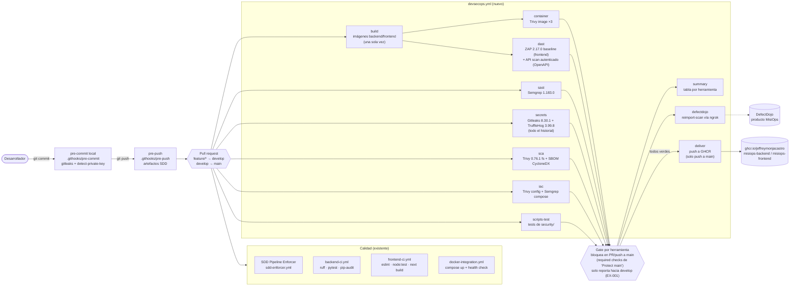

# Pipeline CI/CD de MisiOps

Imagen renderizada: [`../img/pipeline.png`](../img/pipeline.png). Fuente Mermaid abajo.

| Archivo | Rol |
| --- | --- |
| `.github/workflows/devsecops.yml` | Etapas de seguridad, centralización y entrega |
| `.github/workflows/backend-ci.yml`, `frontend-ci.yml` | Lint, tests, build y `pip-audit` |
| `.github/workflows/docker-integration.yml` | Levanta el compose y verifica la API |
| `.github/workflows/sdd-enforcer.yml` | Exige los artefactos SDD en PRs `feature/*` |
| `.githooks/pre-commit`, `.pre-commit-config.yaml` | Bloqueo local de secretos |
| `.githooks/pre-push` | Bloqueo local sin artefactos SDD |
| `security/scripts/*` | Gate, filtro de Trivy, subida e importación a DefectDojo |
| `security/zap/rules.conf`, `.gitleaks.toml`, `security/trufflehog-exclude.txt`, `.trivyignore.yaml`, `.semgrepignore` | Configuración y excepciones justificadas |
